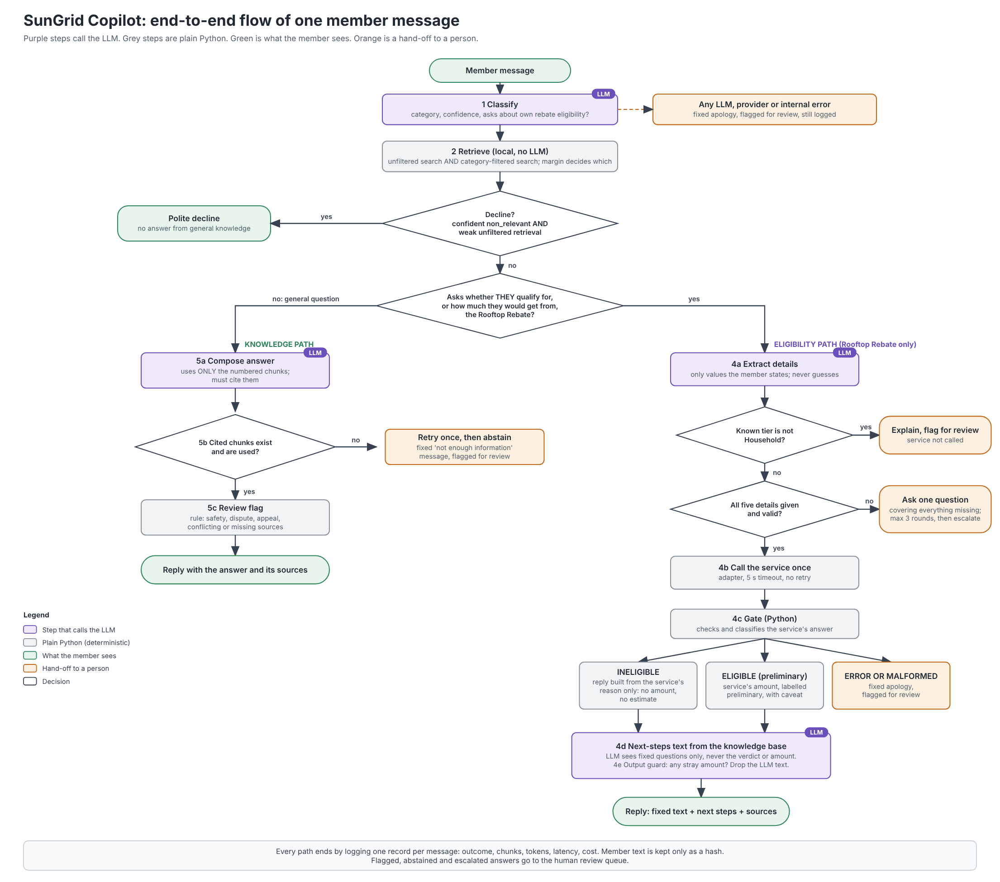

# SunGrid Cooperative Copilot

The SunGrid Cooperative Copilot answers member questions from a 14-document knowledge base and cites its sources.
If the documents do not support an answer, it abstains and flags the question for a person. Questions about whether
a member qualifies for the Rooftop Rebate go to a separate eligibility service, and the hard eligibility rule is
enforced in code, not in a prompt: an ineligible member never sees an amount. SunGrid Cooperative is fictional and
all documents are synthetic.

This is a prototype for the Ahya Lead AI & Data Science assessment.

## Contents

- [Key features](#key-features)
- [How it works](#how-it-works)
- [Tech stack](#tech-stack)
- [Project structure](#project-structure)
- [Getting started](#getting-started)
- [Usage](#usage)
- [Evaluation](#evaluation)
- [Testing](#testing)
- [Configuration](#configuration)
- [Assumptions and limitations](#assumptions-and-limitations)
- [Security](#security)

## Key features

- **Category as a retrieval filter, not a router.** The classifier's category narrows the search only if the label
  is confident and the filtered top result is within a margin of the unfiltered one. Otherwise the unfiltered
  results are used and the reason is recorded.
- **Guarded decline.** The only early exit needs both a confident `non_relevant` label and a weak unfiltered score,
  so terse in-scope queries such as "E07" are not refused.
- **Grounded answers.** The composer may use only the numbered chunks. Code rejects missing or unknown citations,
  retries once, then abstains and flags the question for review.
- **Deterministic eligibility gate and output guard.** A pure-Python gate maps the service result to a verdict, and
  the reply is fixed text. LLM-written next steps are dropped if the guard finds an amount other than the service's.
- **Privacy-preserving logging.** The log stores a SHA-256 hash and the length of each question, never its text,
  ZIP, income or any other slot value.
- **Latency and cost tracking.** Each log record has per-call tokens, latency per step and estimated cost.
- **Offline test suite.** The tests use a fake LLM client and need no key or network.
- **Evaluation harness.** A 20-question set with automatic behaviour checks, optional hand grading and a
  full-context baseline.

## How it works

1. **Classify** (one LLM call): category, self-reported confidence, and whether the message asks about the member's
   own Rooftop Rebate eligibility.
2. **Retrieve** (local, no LLM): an unfiltered and a category-filtered vector search. The filter is used only if the
   label is confident and the filtered top result is within `fallback_margin` of the unfiltered one.
3. **Decline guard**: a confident `non_relevant` label and a weak unfiltered top score end the flow with a polite
   decline.
4. **Knowledge path or eligibility path.**
   - **Knowledge path**: compose an answer from the numbered chunks with checked citations, or abstain.
   - **Eligibility path** (Rooftop Rebate only): extract the details (LLM), ask one combined question for anything
     missing, refuse to check a non-Household tier, validate inputs, call the service once, and map its result
     through the gate. The reply is fixed text from `config/messages.yaml`. Knowledge-base "what happens next" text
     is appended only if the output guard passes.
5. **Log** one JSON line per message to `logs/queries.jsonl`.

The flow of one member message:



## Tech stack

| Layer | Technology | Version | Why |
|---|---|---|---|
| Language | Python | 3.10+ | Pinned versions were installed and tested on 3.10 |
| LLM | Azure OpenAI gpt-4o via the `openai` SDK | openai 3.35.1 | The only provider tested end to end |
| Other LLM clients | OpenAI (`openai`), Anthropic (`anthropic`), Gemini (`google-genai`) | anthropic 1.15.0, google-genai 2.31.0 | Present behind one interface, but only construction-tested |
| Embeddings | fastembed with `BAAI/bge-small-en-v1.5` on CPU (ONNX) | fastembed 0.9.0 | Local, no PyTorch, independent of the chat provider |
| Vector store | Chroma, local and persistent | chromadb 1.5.9 | No server to run |
| Validation | pydantic | 2.14.1 | Validates LLM JSON and settings |
| Configuration | YAML and python-dotenv | PyYAML 6.0.3, python-dotenv 1.2.4 | Settings in files, secrets in the environment |
| Tests | pytest with a fake LLM client | pytest 9.1.1 | Fast, offline, no key |
| Interface | Command line (`argparse`) | standard library | Enough for a prototype |

No agent framework (LangChain, LangGraph): the flow is short and fixed, so plain Python keeps every branch visible
and testable.

## Project structure

```
SunGrid_Starter_Kit/
├── src/sungrid_copilot/                    # The application package
│   ├── __init__.py                         # Package marker
│   ├── agent.py                            # Fixed flow: classify, retrieve, answer or eligibility
│   ├── answer.py                           # Grounded answers from numbered chunks, citation checks
│   ├── cache.py                            # On-disk JSON cache for the tuning commands
│   ├── calibrate.py                        # Threshold tuning on the development set
│   ├── categories.py                       # Loads categories from config/categories.yaml
│   ├── classify.py                         # LLM classifier: category, confidence, eligibility flag
│   ├── cli.py                              # Command-line entry point
│   ├── config.py                           # Settings from config.yaml and environment variables
│   ├── messages.py                         # Fixed member-facing text from messages.yaml
│   ├── querylog.py                         # One JSON line per handled message
│   ├── retrieval.py                        # Category filter, margin fallback, decline guard
│   ├── usage.py                            # Per-call tokens, latency and estimated cost
│   ├── eligibility/                        # Rooftop Rebate path
│   │   ├── __init__.py                     # Package marker
│   │   ├── adapter.py                      # Only code that calls the eligibility service
│   │   ├── flow.py                         # Deterministic flow: ask, refuse, or call once
│   │   ├── gate.py                         # Hard eligibility gate in plain Python
│   │   ├── guard.py                        # Output guard on the final member-facing text
│   │   ├── questions.py                    # One clarifying question for all missing details
│   │   ├── render.py                       # Fixed reply text for each eligibility outcome
│   │   └── slots.py                        # Eligibility details and their LLM extraction
│   ├── evaluation/                         # Evaluation harness
│   │   ├── __init__.py                     # Package marker
│   │   ├── checks.py                       # Automatic checks on one question's record
│   │   ├── full_context.py                 # Baseline: every chunk in one prompt
│   │   ├── report.py                       # results.json, summary.md, grade_sheet.csv, grade merge
│   │   ├── runner.py                       # Runs questions through the agent
│   │   └── schema.py                       # Schema and loader for eval/questions.yaml
│   ├── kb/                                 # Knowledge base
│   │   ├── __init__.py                     # Package marker
│   │   ├── chunking.py                     # Splits documents by ## section
│   │   ├── embeddings.py                   # Local embedders, independent of the chat provider
│   │   ├── ingest.py                       # Manifest to chunks to embeddings to rebuilt store
│   │   ├── manifest.py                     # Loads and validates config/doc_manifest.yaml
│   │   ├── search.py                       # Raw vector search, no LLM
│   │   └── store.py                        # Vector store interface and Chroma implementation
│   └── llm/                                # The only provider-specific code
│       ├── __init__.py                     # Provider-agnostic exports
│       ├── anthropic_client.py             # Anthropic client, not tested end to end
│       ├── azure_openai.py                 # Azure OpenAI client, tested end to end
│       ├── base.py                         # Provider-independent LLM interface
│       ├── factory.py                      # Picks the client from settings
│       ├── fake.py                         # Offline client for tests and LLM_PROVIDER=fake
│       ├── gemini_client.py                # Google Gemini client, not tested end to end
│       └── openai_client.py                # OpenAI client, not tested end to end
├── config/                                 # Non-secret settings
│   ├── categories.yaml                     # Category names, descriptions, examples
│   ├── config.yaml                         # Provider, thresholds, timeouts, logging, pricing
│   ├── doc_manifest.yaml                   # Per-document title, categories, owner
│   └── messages.yaml                       # All fixed member-facing text
├── docs/                                   # 14 knowledge-base documents
├── eval/                                   # Evaluation set and its documentation
│   ├── README.md                           # What the checks do and do not cover
│   ├── RUBRIC.md                           # Rubric for optional hand grading
│   ├── dev_queries.yaml                    # Development set, for calibrate only
│   ├── questions.yaml                      # Evaluation set: 20 questions
│   └── results/                            # (created at runtime, git-ignored) Run folders
├── scripts/                                # Utility scripts
│   └── clean_clone_check.py                # Installs and tests a fresh clone
├── submission/                             # Assessment deliverables, not ingested
│   ├── README.md                           # Folder index
│   ├── ambiguity_note.md                   # Handling of the ambiguous document 06
│   ├── architecture_diagram.png            # Proposed production layout
│   ├── change_control_prompt_and_model.md  # Change control for prompts and models
│   ├── code_review.md                      # Code review
│   ├── delivery_plan_6_week.md             # Prototype to production plan
│   ├── eval_report.md                      # Evaluation report
│   ├── eval_summary.md                     # Raw summary of the reported run
│   ├── executive_brief.pdf                 # Executive brief
│   ├── feedback_note.md                    # Feedback note to the Associate
│   ├── flow_diagram.png                    # Flow of one member message
│   ├── sop_new_document_category.md        # SOP for adding a document category
│   └── technical_design_record.md          # Technical design record
├── tests/                                  # Offline test suite and helpers
├── .cache/                                 # (created at runtime, git-ignored) LLM caches for tuning
├── .chroma/                                # (created at runtime, git-ignored) Vector index
├── logs/                                   # (created at runtime, git-ignored) queries.jsonl
├── .env                                    # (created at runtime, git-ignored) Your local secrets
├── .env.example                            # Variable names with placeholders
├── .gitattributes                          # Line-ending rules
├── .gitignore                              # Secrets and generated files
├── CLAUDE.md                               # Rules file for the AI coding assistant
├── NOTES.md                                # Shortcuts and limitations, one line each
├── README.md                               # This file
├── pyproject.toml                          # Package metadata and pytest settings
├── requirements.txt                        # Pinned dependencies
└── stub_tools.py                           # Eligibility service stand-in, owned by another team; never edited
```

## Getting started

### Prerequisites

- Python 3.10 or newer, and git.
- An Azure OpenAI deployment (I used gpt-4o). The tests need no key.
- Internet access on the first run: the pip packages (about 550 MB installed in the venv) and the embedding model
  (about 65 MB), which fastembed downloads once into its cache.

### Install

Windows PowerShell:

```powershell
git clone <repository-url>
cd SunGrid_Starter_Kit
python -m venv .venv
.venv\Scripts\Activate.ps1
pip install -r requirements.txt
pip install -e .
```

macOS / Linux:

```bash
git clone <repository-url>
cd SunGrid_Starter_Kit
python3 -m venv .venv
source .venv/bin/activate
pip install -r requirements.txt
pip install -e .
```

Run all commands from the repository root: the eligibility service module is loaded from there by name.

### Configure

Copy the template, then fill in one provider block.

Windows PowerShell:

```powershell
Copy-Item .env.example .env
```

macOS / Linux:

```bash
cp .env.example .env
```

| Variable | Meaning |
|---|---|
| `LLM_PROVIDER` | `azure_openai`, `openai`, `anthropic`, `gemini` or `fake`. Overrides `llm.provider` in `config/config.yaml` |
| `AZURE_OPENAI_API_KEY` | Azure OpenAI key |
| `AZURE_OPENAI_ENDPOINT` | Resource root. A full request URL from the portal is also accepted and is reduced to the root |
| `AZURE_OPENAI_DEPLOYMENT` | Deployment name, used as the model |
| `AZURE_OPENAI_API_VERSION` | Optional. This variable wins, then `api-version` in the endpoint URL, then `2024-02-01` |
| `OPENAI_API_KEY` | OpenAI key (untested provider) |
| `OPENAI_MODEL` | OpenAI model name (untested provider) |
| `ANTHROPIC_API_KEY` | Anthropic key (untested provider) |
| `ANTHROPIC_MODEL` | Anthropic model name (untested provider) |
| `GEMINI_API_KEY` | Google Gemini key (untested provider) |
| `GEMINI_MODEL` | Google Gemini model name (untested provider) |

### Check the connection

```
python -m sungrid_copilot.cli check-llm
```

This prints the provider, model, endpoint host and whether the key is set, then makes a test call.

### Build the index

```
python -m sungrid_copilot.cli ingest
```

### Ask a first question

One question:

```
python -m sungrid_copilot.cli ask --once "How long do I have to appeal a rebate decision?"
```

An interactive session (type `exit` to quit):

```
python -m sungrid_copilot.cli ask
```

## Usage

Every command starts with `python -m sungrid_copilot.cli`.

| Command | What it does | Example |
|---|---|---|
| `check-llm` | Smoke-tests the configured provider | `check-llm` |
| `ingest` | Rebuilds the vector index from `docs/` (no LLM) | `ingest` |
| `search` | Raw vector search (no LLM). Options: `--category`, `--top-k`, `--json` | `search "How long do I have to appeal a rebate decision?" --top-k 3` |
| `classify` | Classifies one query. Option: `--no-cache` | `classify "My inverter shows E07"` |
| `retrieve` | Classifies and retrieves, with diagnostics. Options: `--force-category`, `--top-k`, `--no-cache` | `retrieve "How long do I have to appeal a rebate decision?" --force-category program_policies` |
| `calibrate` | Tunes thresholds on the development set. Options: `--dev-set`, `--workers`, `--no-cache` | `calibrate` |
| `eligibility` | Runs the Rooftop Rebate flow from explicit values (no LLM). Omit an option to see the clarifying question | `eligibility --zip 94101 --income 85000 --size-kw 7.5 --installer-approved yes --tier household` |
| `extract-slots` | Extracts eligibility details with the LLM, then shows what the flow would do. Option: `--no-cache` | `extract-slots "I live in 94101 and earn 85000"` |
| `ask` | Asks the Copilot. Options: `--once`, `--debug` | `ask --once "E07" --debug` |
| `eval` | Runs the evaluation set. Options: `--questions`, `--ids`, `--tags`, `--workers`, `--repeat`, `--out`, `--mode` | `eval --workers 3` |
| `eval-summarize` | Merges a filled grade sheet into a run's summary | `eval-summarize eval/results/<run> --grades <filled_grade_sheet.csv>` |

`--debug` on `ask` prints the trace: outcome, each step's latency, chunks and scores, whether the service was called,
the gate verdict, guard violations, tokens and cost. Escalated replies end with "Flagged for human review: <reason>".

## Evaluation

These commands make real LLM calls, so they cost money.

```
python -m sungrid_copilot.cli eval --workers 3                 # full run
python -m sungrid_copilot.cli eval --ids q09,q10               # a subset
python -m sungrid_copilot.cli eval --tags eligibility          # questions with a tag
python -m sungrid_copilot.cli eval --repeat 3                  # stability across repeats
python -m sungrid_copilot.cli eval --mode full-context         # baseline: whole knowledge base in one prompt
```

| Check | Passes when |
|---|---|
| `category_ok` | The classifier category is one of the expected ones |
| `retrieval_ok` | Every expected source document is among the retrieved chunks |
| `cited_ok` | At least one expected source is cited, checked only when the outcome is `answered` |
| `outcome_ok` | The outcome is an allowed one |
| `tool_ok` | The eligibility service was called, or not, as expected |
| `escalation_ok` | The reply was flagged for human review as expected, set on q02 and q09 only |
| `hard_gate_ok` | No `$` in any reply whose outcome forbids amounts |

Each run writes `results.json`, `summary.md`, `grade_sheet.csv` and `queries.jsonl` to `eval/results/<UTC time>/`
(git-ignored).

**Current result:** 18 of 20 questions pass automatically (run 2026-10-30, commit `f06112d`, gpt-4o on Azure OpenAI),
at about $6.40 per 1,000 queries. The two failures are q02 and q13. See the
[evaluation report](submission/eval_report.md).

**The honest limit:** this result comes from automatic checks only, and the replies have not been hand-graded. The
checks compare behaviour, not reply content, so a reply can pass and still be wrong. I wrote the set after my first
demo runs, so it is a regression check, not an accuracy benchmark. See [eval/README.md](eval/README.md) and the
[rubric](eval/RUBRIC.md).

## Testing

```
pytest -q
```

The tests run offline with a fake LLM client, so no key is needed. They use a hash embedder and a temporary Chroma
store, plus the real stub. They also check that no secrets, document file names or document IDs appear in code, and
that retrieval and eligibility do not import each other.

`python scripts/clean_clone_check.py` checks that a fresh clone installs, passes the tests and runs the offline
commands. It needs network access and has been run on Windows only.

## Configuration

The main settings in `config/config.yaml`:

| Setting | Purpose |
|---|---|
| `llm.provider` | Chat provider, overridden by `LLM_PROVIDER` |
| `llm.timeout_s`, `llm.max_retries`, `llm.temperature` | LLM call behaviour |
| `llm.roles` | Per-role model overrides (classifier, extractor, answerer) |
| `embedding.model` | Local embedding model. Changing it means running `ingest` again |
| `retrieval.top_k` | Number of chunks to retrieve |
| `retrieval.classifier_min_conf` | Minimum confidence to use the category filter |
| `retrieval.non_relevant_min_conf` | Minimum confidence to decline |
| `retrieval.fallback_margin` | How far the filtered top score may fall below the unfiltered one (set with `calibrate`) |
| `retrieval.non_relevant_score_ceiling` | Decline only below this unfiltered top score (set with `calibrate`) |
| `eligibility.timeout_s` | Timeout for the single call to the service |
| `agent.max_clarification_turns` | Clarifying turns before escalation |
| `agent.use_llm_cache` | Off, because LLM caches store the member's text |
| `logging.path`, `logging.include_query_text` | Log location, and whether to add the text for local debugging |
| `pricing`, `pricing_model_map` | USD per 1M tokens, for estimated cost |

Other configuration files:

- `config/categories.yaml`: categories, the single source of truth.
- `config/doc_manifest.yaml`: per-document title, categories and owner.
- `config/messages.yaml`: all fixed member-facing text.

## Assumptions and limitations

Assumptions:

- `stub_tools.py` stands in for the eligibility service, which belongs to another team. It is called only through
  `eligibility/adapter.py`, and its logic is not reimplemented. It covers only the Rooftop Rebate, so Battery Storage
  Add-On and Low-Income Bill Credit questions are answered from the documents.
- The kit labels only docs 01 to 05, and 06 as ambiguous. Categories for docs 07 to 14 are my assumption, recorded in
  `config/doc_manifest.yaml`. Owners other than the Incentive Program committee and the Billing team are placeholders.
- Doc 06 is tagged primary `incentive_rebate`, secondary `billing_account`, so billing-worded questions still find it.
  See the [ambiguity note](submission/ambiguity_note.md).
- A non-Household tier gets no check and is flagged for review, because the tier-transfer wording in the documents is
  ambiguous.
- The service reports only the first failing condition, so an ineligible reply never says "the only issue is".
- An eligible result is a preliminary check, not a determination. The reply says funding and documentation
  requirements apply and the committee decides.

Limitations:

- CLI only: there is no API, UI, Docker image or cloud deployment. The production architecture is a proposal in
  [submission/technical_design_record.md](submission/technical_design_record.md).
- Sessions live in memory only. The vector store and LLM caches are local and single-user, and usage tracking is not
  thread-safe for concurrent requests.
- Only Azure OpenAI is tested end to end. The OpenAI, Anthropic and Gemini clients have only offline construction
  tests.
- The eligibility service is called once with a timeout and no retries. Failures escalate to a person.
- The output guard catches `$500`, `USD 500` and `500 dollars` anywhere in the reply. In the LLM-written part of a
  non-eligible reply it also flags bare amounts such as `4,000`, `3k` and `40 cents per watt`. That check fails safe: a
  year or a 3-digit figure drops the next-steps text. Amounts written in words are not caught.
- Classifier confidence is self-reported and uncalibrated. It only widens search, except in the guarded decline.
- Known wrong answer (q02): "Can a Community-tier member run for the board?" gets a flat "no" that the documents do
  not support, with no review flag. `escalation_ok` fails it for the missing flag. Only hand grading can catch the
  wrong "no" itself.
- Over-abstention (q13): "How many members does SunGrid have now?" abstains although the annual report figures were
  retrieved.
- The category filter compares top-1 scores only, so a multi-document question can lose one source.
- The evaluation set is small, so results are counts, not rates.

The code was written with an AI coding assistant (Claude Code) under a written rules file ([CLAUDE.md](CLAUDE.md)),
and reviewed and tested by the author. More limitations, with reasons, are in [NOTES.md](NOTES.md).

## Security

- No keys are committed. Secrets come from environment variables or a git-ignored `.env`, settings objects mask them,
  and a test scans the repo for key-like assignments.
- Member text is logged as a SHA-256 hash and length only, unless `logging.include_query_text` is set to true for
  local debugging.
- LLM caches store the member's text, so they are off for member sessions (`ask` and `eval`). Only the tuning commands
  (`classify`, `calibrate`, `extract-slots`) cache.
